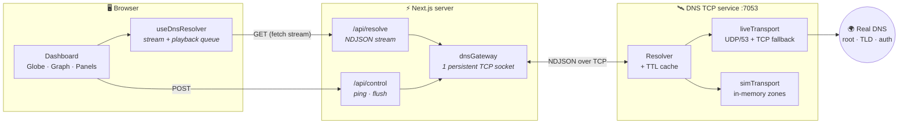
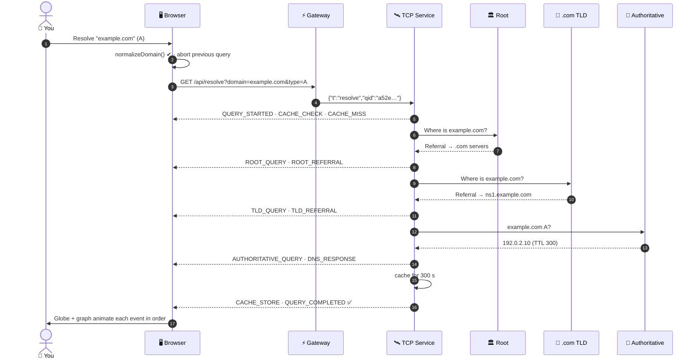
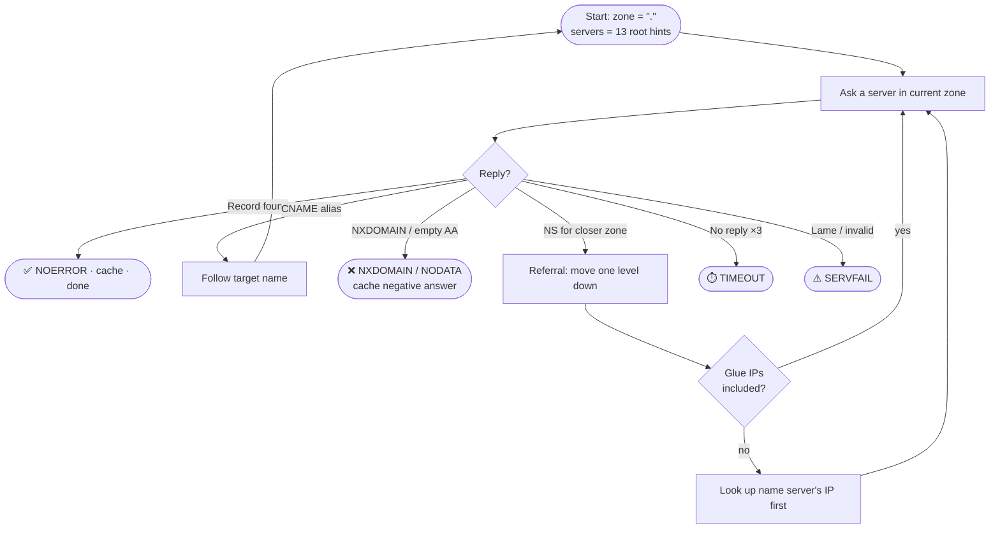

<div align="center">

# 🌐 DNS Resolution Observatory

### *Watch a DNS query travel the world, one hop at a time*


**[Overview](#-overview) · [Architecture](#-architecture) · [A Lookup's Journey](#-a-lookups-journey) · [The Resolver](#-inside-the-resolver) · [Visuals](#-from-events-to-visuals) · [Errors](#-error-handling) · [Run & Test](#-run--test) · [File Map](#-file-map)**

</div>

---

## ✨ Overview

> **One sentence:** you type a domain, a real (or simulated) recursive resolver walks the DNS tree, and every step it takes streams to your browser as an event that animates a **3D globe** and a **node graph**.

<table>
<tr>
<td width="50%" valign="top">

### 🟢 Live DNS mode
Real packets over **UDP/TCP port 53** to the actual
`root-servers.net` → TLD → authoritative servers.
Every address shown is a genuine answer.

</td>
<td width="50%" valign="top">

### 🟠 Simulation mode
An in-memory DNS hierarchy using **documentation-only IPs**
(`192.0.2.0/24`, `2001:db8::/32`, …).
Works offline and is clearly labelled *SIMULATION*.

</td>
</tr>
</table>

> [!IMPORTANT]
> Nothing is faked on the frontend. The animation plays the **exact events the backend emitted**: retries, CNAME restarts, timeouts and all.

---

## 🏗 Architecture



| Layer | Location | Responsibility |
|:--|:--|:--|
| 🛰️ **DNS service** | `server/` | Resolves names, caches answers, emits one event per step |
| ⚡ **Gateway** | `src/server/`, `src/app/api/` | Turns HTTP requests into TCP messages and streams events back |
| 🖥️ **UI** | `src/components/dns/`, `src/hooks/`, `src/lib/dns/` | Plays events back as animation, panels, logs and stats |
| 📜 **Contract** | `src/shared/dns.ts` | One set of types and validation used by **all three** layers |

---

## 🚀 A Lookup's Journey

Follow `example.com A` from click to answer:



<details>
<summary><b>🔍 Step-by-step breakdown</b> (click to expand)</summary>

| # | Where | What happens |
|:-:|:--|:--|
| 1 | `Dashboard.tsx` | Input checked by `normalizeDomain()`: no spaces, no URLs, no IPs, IDN converted to punycode |
| 2 | `useDnsResolver.ts` | Any in-flight query is **aborted**; a new run ID is created |
| 3 | `api/resolve/route.ts` | Generates a `qid`, subscribes, writes one JSON line to TCP |
| 4 | `server/index.ts` | Validates again (never trusts the client), picks the live or sim resolver |
| 5 | `server/resolver.ts` | Walks the tree and emits events |
| 6 | Gateway → browser | Each event is forwarded as one NDJSON line; the stream closes on completion |
| 7 | `useDnsResolver.ts` | Events are queued and **played back one per step** (900 ms at 1×) |
| 8 | `visuals.ts` | `deriveJourney()` turns the played events into node states and the active edge |
| 9 | Globe + Graph | Both render the same `Journey`, so they always agree |

</details>

### 📦 Anatomy of an event

```jsonc
{
  "qid":  "a52ec96a",          // which query
  "seq":  4,                    // order within the query
  "ts":   1760340000123,        // backend timestamp (ms)
  "type": "ROOT_REFERRAL",      // what happened
  "node": "resolver",           // where it lands
  "from": "root",               // who sent it → defines the animated edge
  "msg":  "b.sim-root.invalid refers resolver to .com name servers…",
  "data": { "zone": "com", "ns": ["a.sim-tld-com.invalid"], "rttMs": 48 }
}
```

<details>
<summary><b>📋 All 14 event types</b></summary>

| Event | Edge | Meaning |
|:--|:--|:--|
| `QUERY_STARTED` | client → resolver | Client sends a recursive query |
| `CACHE_CHECK` | resolver → cache | Look for an unexpired answer |
| `CACHE_HIT` | cache → resolver | Found it, with TTL remaining |
| `CACHE_MISS` | cache → resolver | Nothing valid, so walk the tree |
| `ROOT_QUERY` | resolver → root | Ask a root server |
| `ROOT_REFERRAL` | root → resolver | "Ask the `.com` servers" |
| `TLD_QUERY` | resolver → tld | Ask a TLD server |
| `TLD_REFERRAL` | tld → resolver | "Ask the domain's name servers" |
| `AUTHORITATIVE_QUERY` | resolver → auth | Ask the zone owner |
| `AUTHORITATIVE_REFERRAL` | auth → resolver | Further sub-delegation |
| `DNS_RESPONSE` | server → resolver | Record, CNAME or definitive negative answer |
| `CACHE_STORE` | resolver → cache | Saved for TTL seconds |
| `QUERY_COMPLETED` | resolver → client | Final answer ✅ |
| `QUERY_FAILED` | resolver → client | NXDOMAIN / NODATA / TIMEOUT / SERVFAIL ❌ |

</details>

---

## 🔬 Inside the Resolver

### 🌳 Iterative resolution

A real recursive resolver doesn't ask one server for everything. It **walks down the tree**, following referrals:



**Which node lights up?** That depends on the zone being asked:

| Zone | Example | Node |
|:--|:--|:--|
| `.` | the root | 🏛️ **Root** |
| one label | `com`, `uk` | 🔀 **TLD** |
| deeper | `example.com`, `bbc.co.uk` | 📗 **Authoritative** |

### 🛡 Safety limits

| ⏱️ Per-server timeout | 🔁 Servers tried per step | ⌛ Query deadline | 🔗 Max CNAME hops | 🪜 Max steps |
|:-:|:-:|:-:|:-:|:-:|
| **2 s** | **3** (random order) | **15 s** | **8** | **24** |

### 💾 The TTL cache

- 🔑 The key is `name|type`, e.g. `example.com|A`.
- ⏳ Each entry expires at `now + TTL` (capped at 1 day). A cache hit reports the **remaining** TTL.
- 🚫 **Negative answers are cached too** (NXDOMAIN/NODATA, using the SOA minimum TTL), just like real resolvers.
- 🔀 Live and sim modes have **separate caches**.
- 🧹 **Flush cache** in the UI sends `{"t":"flush"}` to clear one mode.

> [!NOTE]
> Only final answers are cached, not referrals. That is deliberate: every cache miss walks the full **root → TLD → authoritative** chain, so you can always see it.

### 🔌 Two transports, one resolver

The resolver never knows whether it's talking to the real internet. It just calls `transport.query()`.

<table>
<tr><th>🟢 <code>liveTransport</code></th><th>🟠 <code>simTransport</code></th></tr>
<tr>
<td valign="top">

- `wire.ts` builds a real **RFC 1035** packet (RD = 0, EDNS0)
- Sends over **UDP/53** and accepts replies only from the right IP with the matching ID
- **TC bit set?** Retries over **TCP**
- Decodes compressed names plus A, AAAA, NS, CNAME and SOA records
- Starts from the official **IANA root hints**

</td>
<td valign="top">

- Nested in-memory tree: root → `com/org/net/io` → domains
- **Documentation-only IPs** that can never be real
- Artificial 25–85 ms latency
- Returns the **same message shape** as a real server
- Includes ready-made test scenarios ⬇️

</td>
</tr>
</table>

#### 🧪 Simulation scenarios

| Query | Demonstrates |
|:--|:--|
| `example.com A` | Full miss, then a **cache hit** on repeat |
| `www.example.com AAAA` | **CNAME** alias, so the resolver restarts at the root |
| `wiki.org AAAA` | IPv6 answer |
| `glueless.org A` | Delegation **without glue** |
| `acme-shop.com AAAA` | **NODATA**: the name exists but has no IPv6 record |
| `nope.example.com A` | **NXDOMAIN** |
| `www.deadzone.io A` | Authoritative server is silent, giving a **TIMEOUT** |

---

## 🎨 From Events to Visuals

### ⏯ The playback queue

Backend events arrive fast: under 1 ms for a cache hit, about 200 ms for a miss. The hook **queues** them and reveals one per step:

```
received  [ e0 e1 e2 e3 e4 e5 e6 e7 e8 e9 e10 ]   ← filled as the stream arrives
cursor              ▲                             ← advances every 900 ms ÷ speed
played    [ e0 e1 e2 ]                            ← what's on screen
```

| Guarantee | How |
|:--|:--|
| 🚫 **No overlapping animations** | Only one run owns the cursor |
| 🧊 **No stale results** | Every update is tagged with a run ID; late events from old searches are dropped |
| 🔁 **Replay** | Just resets the cursor to 0 |
| 🎚 **Speed** | 0.5× · 1× · 2× · 4× changes the step length only, never the data |

### 🗺 One rule table drives everything

`src/lib/dns/visuals.ts` holds a `RULES` entry per event type:

```ts
ROOT_REFERRAL: {
  kind:    "referral",                                  // → 🟣 purple
  stage:   "Root referral",                             // stage-panel title
  explain: "The root replies with a referral …",        // teaching text
  label:   (e) => `Referral: .${e.data.zone}`,          // edge label
  states:  (e) => ({ root: "referral", resolver: "referral" }),
}
```

`deriveJourney(played)` folds the played events through `RULES` and produces one **`Journey`** object, which **both views read**.

### 🎨 Colour language

| | Kind | Used for |
|:-:|:--|:--|
| 🔵 | `query` | Outgoing DNS query |
| 🟣 | `referral` | Referrals, routing, CNAME aliases |
| 🟢 | `success` | Answers, cache hits |
| 🟠 | `process` | Cache check, cache miss, cache store |
| 🔴 | `error` | Failure, timeout, NXDOMAIN |

### 🧭 Node states

`Idle` · `Active` · `Query sent` · `Waiting for response` · `Cache hit` · `Cache miss` · `Referral received` · `Resolved` · `Failed`

---

## 🖼 The Two Views

<table>
<tr>
<td width="50%" valign="top">

### 🌍 3D Globe
| File | Role |
|:--|:--|
| `GlobeView` | Browser-only load and WebGL check, with the graph as fallback |
| `GlobeScene` | Canvas, stars, orbit controls, zoom API, camera easing |
| `Earth` | Day/night shader, city lights, ocean glint, clouds, atmosphere |
| `Network` | Markers, cache ring, arcs, glowing particle with trail, labels |
| `math` | Lat/lon → 3D position, great-circle arcs |

</td>
<td width="50%" valign="top">

### 🕸 Graph
- Built with **React Flow** and custom nodes (icon, label, status dot, explanation)
- **Star layout** around the resolver, because in iterative DNS the resolver talks to each server itself
- The active edge shows a flowing dashed line, a label and a travelling dot, which runs **backward for responses**

</td>
</tr>
</table>

> [!WARNING]
> **Globe locations are illustrative.** Root servers and many TLD servers are *anycast*, meaning hundreds of sites share one IP. An IP address doesn't reveal physical location, and arcs show **who talks to whom**, not the route packets take. Every label says so.

<details>
<summary><b>📍 Where each marker is placed</b></summary>

| Node | Placement (`src/lib/dns/geo.ts`) |
|:--|:--|
| 💻 Client / ⚙️ Resolver | From the **"Client:"** preset (London, New York, Tokyo, …) |
| 🏛️ Root | Nearest anycast-style site to the resolver |
| 🔀 TLD | Per-TLD site (`com` → Reston VA, `uk` → London, …) |
| 📗 Authoritative | Deterministic pick from a data-centre list (hash of the zone) |

</details>

---

## 📡 Wire Protocol

Both TCP and HTTP use **newline-delimited JSON**. Control messages are kept separate from DNS events.

<table>
<tr><th>➡️ Client → Service</th><th>⬅️ Service → Client</th></tr>
<tr>
<td valign="top">

```json
{"t":"resolve","qid":"…","domain":"…",
 "qtype":"A","mode":"live"}
{"t":"cancel","qid":"…"}
{"t":"flush","mode":"sim"}
{"t":"ping"}
```

</td>
<td valign="top">

```json
{"t":"event","e":{ …DnsEvent… }}
{"t":"error","qid":"…",
 "code":"INVALID_DOMAIN","msg":"…"}
{"t":"flushed","mode":"sim","removed":3}
{"t":"pong","version":1}
```

</td>
</tr>
</table>

| Endpoint | Method | Purpose |
|:--|:-:|:--|
| `/api/resolve` | `GET` | Streams the events for one query |
| `/api/control` | `POST` | `ping` (health check), `flush` (clear cache) |

---

## 🧯 Error Handling

| Problem | Caught by | You see |
|:--|:--|:--|
| ✏️ Invalid domain | browser **and** service | Red hint under the input |
| 🔤 Unsupported type (MX…) | service | `UNSUPPORTED_TYPE` |
| 🔌 TCP service down | gateway | Red banner with a **Retry** button |
| ⏱️ Silent server | resolver | `TIMEOUT`; the failing node turns red |
| ❓ NXDOMAIN / NODATA | resolver | Red/amber result; the resolver still shows *Resolved* |
| ⚠️ Lame delegation | resolver | `SERVFAIL` |
| 💥 Connection lost mid-query | gateway | `BACKEND_UNAVAILABLE` |
| 🔁 New search / tab closed | `AbortController` → `cancel` | Old query stops and is ignored |
| 🖥 No WebGL | `GlobeView` | Notice, with the graph shown instead |

---

## 📊 Statistics & History

When a run's **final event finishes playing**, one row is added to the history (50 max):

```
time · domain · type · mode · status · addresses · cached? · duration
```

| 🔢 Total | ✅ Successful | ❌ Failed | ⚡ Cache hits | 🐢 Cache misses | ⏱️ Avg time |
|:-:|:-:|:-:|:-:|:-:|:-:|
| all runs | ≥ 1 address | everything else | served from cache | full walks | **real backend time**, not animation |

---

## 🏁 Run & Test

```bash
npm install
npm run dev        # 🛰️ TCP service :7053  +  ⚡ Next.js :3000
```

| Command | Does |
|:--|:--|
| `npm run dev` | TCP service + Next.js dev server together |
| `npm run dns-server` | TCP service only (`DNS_TCP_HOST` / `DNS_TCP_PORT` to override) |
| `npm run dev:web` | Next.js only |
| `npm run build && npm start` | Production |
| `npm test` | Integration tests over real TCP (`SKIP_LIVE=1` to skip the internet test) |
| `npm run typecheck` · `npm run lint` | Static checks |

> [!TIP]
> Live mode needs outbound **port 53**. Behind a strict firewall, use Simulation mode.

**What `npm test` verifies:**
- ✅ Exact event order for a cache miss, then a cache hit (no root/TLD/auth events)
- ✅ AAAA, the CNAME restart, NXDOMAIN, NODATA and a glueless delegation
- ✅ A timeout that reports which node failed
- ✅ Validation and unsupported types
- ✅ One **real** iterative lookup of `example.com`

---

## 🗂 File Map

```
📁 server/                       🛰️ DNS TCP service
├── main.ts                      start the service
├── index.ts                     TCP server · NDJSON · validation · cancel/flush/ping
├── resolver.ts                  iterative resolver · TTL cache · events
├── transport.ts                 live UDP/TCP + simulated hierarchy
├── wire.ts                      DNS packet encoder/decoder
└── resolver.test.ts             integration tests

📁 src/
├── shared/dns.ts                📜 shared types · protocol · validation
├── server/dnsGateway.ts         ⚡ persistent multiplexed TCP client
├── app/api/resolve/route.ts     ⚡ event stream
├── app/api/control/route.ts     ⚡ ping + flush
├── hooks/useDnsResolver.ts      ⏯ streaming · playback · history · stats
├── lib/dns/visuals.ts           🎨 event → state / edge / colour rules
├── lib/dns/geo.ts               📍 illustrative locations
└── components/dns/
    ├── Dashboard.tsx            🖥 layout & controls
    ├── DnsGraph.tsx             🕸 React Flow graph
    ├── ui.tsx                   🧩 panels · log · history · stats · legend
    └── globe/                   🌍 view · scene · earth · network · math

📁 public/textures/              🖼 Earth textures (NASA imagery via three.js examples)
```

---

<div align="center">

**🌐 Type a domain → watch it travel → see the answer come home.**

<sub>Live answers are real · Simulated answers use reserved documentation IPs · Globe positions are illustrative</sub>

</div>
